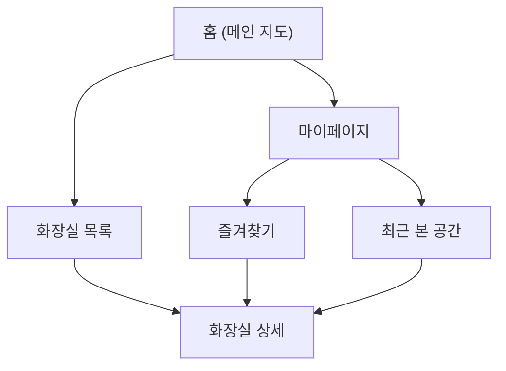
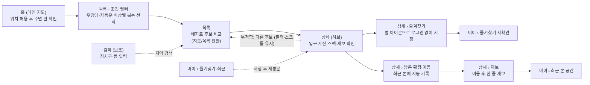
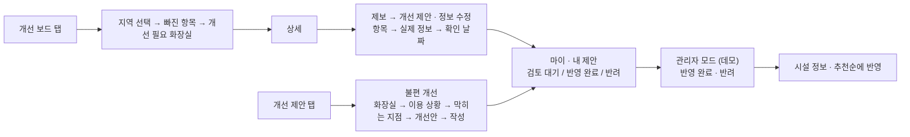

# Restie — 공공화장실 큐레이터 · 안심 지도

> 이용자 상황(휠체어, 영유아 동반, 야간 귀가 등)에 맞는 공공화장실을 찾고,
> 실제와 다르거나 불편한 점을 시민이 **개선 제안**으로 올려 데이터를 함께 고쳐 나가는 서비스입니다.

| 항목 | 내용 |
| --- | --- |
| 현재 버전 | **v0.5** (프로토타입) — v0.1~v0.4 와이어프레임 |
| 최종 수정일 | 2026-11-16 |
| 담당 | 24730066_안혜주, 24730078_최선경 |
| 형태 | HTML · CSS · JavaScript 정적 웹 (모바일 세로 화면 기준) |
| 기획 | 노션 4주차 (2026-09-28) — 기능 우선순위 · MVP · 사이트맵 · User Flow |

## 목차
1. [변경 이력](#1-변경-이력)
2. [PRD](#2-prd)
   - [2.1 핵심 사용자 시나리오](#21-핵심-사용자-시나리오) · [2.2 문제 우선순위 → 기능 후보](#22-문제-우선순위--기능-후보)
   - [2.3 기능 우선순위](#23-기능-우선순위-must--should--could) · [2.4 MVP 범위](#24-mvp-범위) · [2.5 사이트맵](#25-사이트맵) · [2.6 User Flow](#26-user-flow)
3. [데이터 정리 (JSON · API)](#3-데이터-정리-json--api)
4. [생성형 AI 도구](#4-생성형-ai-도구)
5. [실행 방법 · 폴더 구조](#5-실행-방법--폴더-구조)

---

## 1. 변경 이력

> 최신 버전이 맨 위에 오도록 **내림차순**으로 적습니다. 날짜는 각 버전 폴더의 파일 수정일 기준입니다.
> 분류: `추가` · `변경` · `디자인` · `데이터` · `수정` · `삭제`

### 버전별 한눈에 보기
| 버전 | 날짜 | 핵심 변화 | 하단 탭바 | 화면 | 데이터 | 코드 규모 |
| --- | --- | --- | --- | --- | --- | --- |
| **v0.5** | 2026-11-16 | 프로토타이핑 완료: 디자인 시스템 · 추천순 · 사진 · 로그인/회원가입 페이지 · 관리자 데모 | Restie(지도) / 개선 제안 / 개선 보드 / 마이페이지 | 8 | J 200 + A 302 + 샘플 제안 107 | 약 5,200줄 |
| **v0.4** | 2026-11-09 | 개선 제안 신설 · 대시보드 → 개선 보드 | 지도 / 개선 보드 / 개선 제안 / 마이 | 6 | J 200 + A 302 | 약 3,700줄 |
| **v0.3** | 2026-11-03 | 카카오맵 · 실제 공공데이터 연동, 로드뷰 | 지도 / 대시보드 / 마이 | 5 | J 200 + A 302 | 약 2,900줄 |
| **v0.2** | 2026-10-19 | 목록 바텀시트 · 로그인/회원가입 | 지도 / 대시보드 / 마이 | 5 | 샘플 7 | 약 2,000줄 |
| **v0.1** | 2026-10-12 | 노션 기획 기반 첫 와이어프레임 | Restie(홈) / 목록 / 대시보드 / 마이 | 5 | 샘플 7 | 약 1,600줄 |

### 버전별 화면 구성 비교
| 화면 | v0.1 | v0.2 | v0.3 | v0.4 | v0.5 |
| --- | --- | --- | --- | --- | --- |
| 홈 (지도) | 더미 지도 + 상태별 핀(개방·미확인·고장), 검색창, 조건 칩, 목록으로 보기 | + 목록 바텀시트(닫힘·절반·전체), 칩 동기화 | 카카오맵 실제 지도, J/A 핀, 핀 카드, 로드뷰 | 동일 | 거리순 · 추천순, 시트를 올리면 남은 지도 가운데에 내 위치, 선택 핀 확대 · 목록 맨 위 고정, 카드 썸네일 |
| 조건 필터 | 무장애 · 자동문 · 기저귀교환대 · 비상벨 (1개 선택) | 동일 | 무장애 · 비상벨 · CCTV · 기저귀교환대 (복수 선택) | 동일 | 동일 (반영 완료된 정보 수정 제안이 시설 정보에 반영) |
| 목록 | 필터 · 거리순 ↔ 마감 시간순 · 결과 없음/오류 상태 | 탭에서 빠지고 바텀시트로 흡수 | 실제 거리(도보 N분) · 출처 배지 | 동일 | 시설 배지 전부 표시(턱없음·비상벨·CCTV·기저귀교환대·24시간), 지역 · 거리 · 도보 N분 |
| 상세 | 판단 정보: 턱/계단 · 자동문 · 회전 공간 · 기저귀 교환대 · 비상벨 · 24시간, 즐겨찾기, 제보(자리만) | 동일 | 판단 정보: 장애인화장실 · 기저귀 교환대 · 비상벨 · CCTV · 안심 시설 대상 · 운영시간, 남/여 위치 아이콘 | 제보 · 개선 제안 버튼 연결 | 맨 위 사진 슬라이드, '시설 및 이용 안내', '위치 및 상세 정보' 아래 지도 ↔ 로드뷰, 헤더 별 즐겨찾기 |
| 마이 | 즐겨찾기 · 최근 본 공간 | + 로그인 · 회원가입 | 동일 | + 내 제안 (상태 확인 · 취소) | 로그인 전/후 화면 분리, 프로필 · 제안 현황 · 내 개선 제안 · 설정(내 이용 상황) · 도움말 · 관리자 모드(데모) |
| 로그인 · 회원가입 | – | 마이 안에 포함 | 동일 | 동일 | **별도 페이지** (`login.html` · `signup.html`) + 상단 헤더 로그인/로그아웃 아이콘 |
| 대시보드 / 개선 보드 | 전국 현황 · 지역별 무장애 막대그래프 · 내 지역 요약 | 동일 | 서울 현황 · 나에게 맞는 화장실 보기(이용자 유형 10가지) | 개선 보드: 지역 빈칸 · 먼저 개선할 분야 · 개선 필요 화장실 · 최근 제안 | + 이용자별로 부족한 점 |
| 개선 제안 | – | – | – | 불편 개선 · 정보 수정 | + 사진 첨부(최대 3장), 내 이용 상황 표시, 추천 개선안 강조 |

### v0.5 — 2026-11-16 · 프로토타입 (프로토타이핑 완료)
> v0.1~v0.4 와이어프레임을 실제로 쓸 수 있는 수준의 화면 · 동작으로 다듬은 버전

**추가**
- **추천순 정렬** (목록 · 바텀시트): 조건 버튼에 맞는 화장실은 모두 표시하고 순서만 개선 제안으로 보정
  1. 누른 조건 시설에 대한 제안 점수: 반영 완료 +1 · 검토 대기 −1 · "실제로는 없음" 검토 대기 −2 (조건이 '전체'면 0)
  2. 그 화장실의 모든 제안 점수: 반영 완료 +1 · 검토 대기 −1 · 반려 0
  3. 거리
- **제안 → 시설 정보 반영**: 반영 완료된 정보 수정 제안은 실제 정보로 보고 시설 값을 고침 (원래 공공데이터 값은 따로 보관, 나중에 반영된 제안이 우선)
- **화장실 사진**: 상세 맨 위 사진 슬라이드(화살표 · 좌우 밀기), 목록 카드 썸네일
  - 이미지 규칙 `data/toilet_images_sample.json` — 장소 유형(지하철역 · 지하상가 · 공원 · 공공기관 · 기타) + 시설(장애인용 칸 · 기저귀 교환대) 이미지, 최대 4장
  - 이미지 `img/toilets/*.svg` 8종 (사람이 나오지 않는 일러스트)
- **시연용 샘플 개선 제안** `data/proposals_sample.json` 107건 — 첫 접속 때 자동 입력, '며칠 전' 기준이라 언제 열어도 최근 제안처럼 보임
- **로그인 · 회원가입 별도 페이지** (`pages/login.html`, `pages/signup.html`)
- **공통 상단 헤더** (개선 제안 · 개선 보드 · 마이페이지): 로고 + Restie(누르면 지도), 오른쪽 로그인 / 로그아웃 아이콘 — 로고 `img/logo.svg`
- 마이페이지
  - 로그인 전: 즐겨찾기 · 최근 본 화장실(5곳), 로그인하면 할 수 있는 것, 도움말
  - 로그인 후: 프로필 · 제안 현황, 내 개선 제안(검토 상태별 보기), 설정(내 이용 상황 · 알림)
  - **관리자 모드 (데모)**: 제안별 검토 결과(반영 완료 · 반려)와 메모를 바꿔 볼 수 있음
- 개선 보드 **이용자별로 부족한 점** (개선 제안의 이용 상황과 같은 이름)
- 개선 제안 **사진 첨부 (선택, 최대 3장)** — 불편 개선 · 정보 수정 공통, 사진 자체는 저장하지 않고 장수만 기록
- 지도: 선택한 핀 1.4배 확대, 내 위치 표시(하늘색 원 + 파란 점), 목록을 올렸을 때 지도에서 고른 화장실을 목록 맨 위에 구분해서 표시

**변경**
- 탭바 순서: 지도 / 개선 보드 / 개선 제안 / 마이 → **Restie(지도) / 개선 제안 / 개선 보드 / 마이페이지**, 지도 탭은 위치핀 선 아이콘, 선택된 탭은 검정
- 목록 바텀시트를 올리면 **남은 지도 영역 가운데에 내 위치**가 오도록 지도 이동
- 목록 카드: 시설 배지는 정렬과 상관없이 실제 있는 정보를 모두 표시, 추천순에서도 거리 표시
- 상세: 지도를 맨 위에서 **'위치 및 상세 정보' 아래**로 옮기고 그 자리에 사진 (기존 영역 크기 유지, 스크롤), 지도 ↔ 로드뷰 전환
- 개선 제안: 불편 개선 / 정보 수정 전환을 본문 맨 위로, 화장실 · 이용 상황을 고르기 전에는 결과 영역을 비워 둠, 추천 개선안은 파란 테두리로 표시, 제출 후 페이지 이동 없이 안내 후 입력 초기화

**디자인**
- 디자인 시스템 확정
  - 메인 `#00B3FF` · 보조 `#E5F7FF` · 진한 메인 `#0089C7` · 포인트 `#C98A2C` / `#FBF0DD`
  - 폰트 **Pretendard**
  - 텍스트 외 색상은 파랑 · 하늘 계열, 메인 컬러는 포인트로만 사용
- 기준 레이아웃: 연한 회색 바탕 + 블루 · 오렌지옐로 그라데이션 배경 + 테두리 없는 반투명 흰 카드 (개선 제안 화면 → 서비스 전체)
- 정보만 보여 주는 화면은 색을 적게, 디자인 수정 때 영역 위치 · 글자 크기는 유지
- 출처 핀: J 초록 `#22B75E` · A 노랑 `#FFB400`

### v0.4 — 2026-11-09 · 개선 제안 · 개선 보드
**추가**
- **개선 제안** 화면 신설 (`pages/propose.html`)
  - 불편 개선: 화장실 선택 → 이용 상황(6가지) → 막히는 지점 확인 → 개선안 선택(15종) → 내용 작성
  - 정보 수정: 항목(장애인화장실·기저귀 교환대·비상벨·CCTV·운영시간 등) → 실제 정보 → 확인 날짜
  - 상세 화면의 `제보` · `개선 제안` 버튼이 해당 화장실을 미리 고른 채 연결됨 (`?id=…&mode=info&item=broken`)
- 마이 → **내 제안** 탭: 상태(검토 대기 / 반영 완료 / 반려) 확인, 검토 대기 제안 취소
- 개선 제안 LocalStorage 저장 (`pt_proposals`)

**변경**
- 탭바: 지도 / 대시보드 / 마이 → **지도 / 개선 보드 / 개선 제안 / 마이** (4개)
- 대시보드 → **개선 보드**로 개편: 지역 선택, 지역 데이터 요약(핵심 항목 등록률·검토 대기 제안·가장 많이 빠진 항목), 먼저 개선할 분야, 개선이 필요한 화장실(최대 5곳), 제안이 반영되는 흐름, 최근 제안
- 상세 화면 `제보` 버튼: "준비 중" 안내창 → 정보 수정 제안으로 연결

### v0.3 — 2026-11-03 · 실제 데이터 · 카카오맵 연동
**추가**
- **카카오맵 SDK 연동** (`js/kakao-map.js`, `js/config.js`): 실제 지도, 화장실 핀, 핀 선택 카드
- **로드뷰**: 카카오맵으로 나가지 않고 화면 위에서 보기
- 실제 공공데이터 도입
  - J: `data/toilets_seoul_jung.json` — 서울 중구·종로구 공공화장실 200건 (주소 → 좌표 변환 후 캐시)
  - A: 서울교통공사 역사공중화장실정보 Open API + 대체본 `data/toilets_subway.json` 302건
- 내 위치 기준 거리 계산(도보 N분), 위치 권한 전 기본값 서울시청
- 출처 표시 배지 J / A, 남·여 아이콘으로 비상벨·기저귀 교환대 위치 표시
- 상세 판단 정보를 공공데이터 항목으로 교체: 장애인화장실 · 기저귀 교환대 · 비상벨 · CCTV · 안심 시설 대상 · 운영시간 (값이 없으면 '정보 없음')
- 데이터 불러오기 실패 상태 화면
- 대시보드 **"나에게 맞는 화장실 보기"**: 이용자 유형 10가지 캐러셀 → 기본 데이터 → 유저 니즈 → 추천 (공공데이터에 없는 항목은 가상 데이터 D로 표시)

**변경**
- 조건 칩: 무장애 / 자동문 / 기저귀교환대 / 비상벨 → **무장애 / 비상벨 / CCTV / 기저귀교환대** (공공데이터에 있는 항목 기준), 여러 개 동시 선택
- 대시보드 범위: 전국 현황 → **서울** 공공화장실 현황
- 목록·표는 3개까지만 보이고 `상세보기`로 펼치기
- J에 있는 지하철역 화장실은 A의 자세한 정보로 대체(중복 숨김)
- 상태별 핀(개방 · 미확인 · 고장) → 출처별 핀(J / A)
- 로컬 서버(또는 GitHub Pages)로 열어야 동작 (`fetch()` 사용)

**삭제**
- 자동문 · 회전 공간 조건 (공공데이터에 항목이 없음)

### v0.2 — 2026-10-19 · 지도 + 목록 바텀시트 · 계정
**추가**
- 홈 지도에 **목록 바텀시트** (닫힘 → 절반 → 전체, 드래그·속도 반영), 시트 제목 "주변 화장실 N곳"
- 지도 위 / 시트 위 조건 칩 동기화, 목록 카드 즐겨찾기 ★ 토글, 결과 없음 상태
- 마이 화면에 **로그인 · 회원가입** (데모용 LocalStorage, 비밀번호 해시 저장)
- 마우스 좌우 드래그 스크롤 (칩 영역)

**변경**
- 탭바: Restie(홈) / 목록 / 대시보드 / 마이 → **지도 / 대시보드 / 마이** (목록 탭은 바텀시트로 흡수)
- 탭 아이콘을 SVG 선 아이콘으로 교체

**삭제**
- 홈 메뉴 버튼(☰)

### v0.1 — 2026-10-12 · 첫 와이어프레임
> 노션 기획(2026-09-28)의 사이트맵 · User Flow를 바탕으로 만든 첫 화면 구현

**추가**
- 화면 5개: 홈(지도 자리) · 목록 · 상세 · 마이 · 대시보드
- 탭바: Restie(홈) / 목록 / 대시보드 / 마이
- 홈: 지역·화장실명 검색창, 메뉴(☰), 더미 지도 + 상태별 핀(개방 · 미확인 · 고장), 현재 위치 버튼, 목록으로 보기
- 조건 칩: 전체 · 무장애 · 자동문 · 기저귀교환대 · 비상벨 (노션 기획의 맞춤 조건 필터)
- 목록: 조건 필터, 정렬(거리순 ↔ 마감 시간순), 결과 없음 · 오류 상태
- 상세: "판단 정보 · 방문 전 꼭 확인" — 턱/계단 · 자동문 · 회전 공간(1.4m 이상) · 기저귀 교환대 · 비상벨 · 24시간 개방, 즐겨찾기 저장, 제보 버튼(자리만)
- 마이: 즐겨찾기 / 최근 본 공간 탭 (LocalStorage)
- 대시보드: 전국 공공화장실 현황, 지역별 무장애 화장실 막대그래프, 내 지역 요약
- 샘플 데이터 `data/toilets.json` 7건 (노션 시나리오의 홍대입구 일대 가상 데이터)
- `fetch()` 실패 시 `js/app.js` 안의 내장 샘플로 자동 대체 (파일 더블클릭으로도 확인 가능)

**디자인**
- 메인 컬러 `#2F5D5A`(딥 그린), 진한색 `#22433F`, 연한색 `#E7EFEE`

---

## 2. PRD

> 기획 원본: 노션 「4주차 — 1.4 기능 우선순위와 MVP 범위 결정 · 2.5 사이트맵과 User Flow 설계」 (2026-09-28)
> PRD를 고치면 상단 '최종 수정일'과 [변경 이력](#1-변경-이력)에도 함께 적어 주세요.

### 2.1 핵심 사용자 시나리오
**외출 중 무장애(Barrier-Free) 화장실을 급하게 찾아야 하는 20대 휠체어 이용자 — 박지훈(28세)**

토요일 오후 3시, 홍대입구역 인근에서 모임을 마치고 이동하던 중 급하게 화장실이 필요해졌다.
지도 앱의 '장애인 화장실' 표시를 보고 찾아간 건물은 입구 계단 때문에 들어갈 수 없었고, 다음 후보는 장애인 화장실 안에 청소도구와 카트가 쌓여 회전할 공간이 없었다.
결국 지하철역 깊숙한 곳의 화장실까지 20분 넘게 돌아가야 했고, 이후 외출 때는 물이나 음료를 일부러 참는 악순환을 겪는다.

| 항목 | 내용 |
| --- | --- |
| **상황** | 주말 오후, 낯선 상권 이동 중 급한 무장애 화장실 이용 필요 |
| **목표** | 이동 전에 입구 단차 없이 실제 휠체어 진입·이용이 가능한 화장실 한 곳을 **1~2분 내 확정** |
| **제약** | 스마트폰 세로 화면, 이동 중 한 손 또는 보조기기 조작, 빠른 결정, 크고 직관적인 픽토그램·사진 정보 선호 |
| **결과** | 단차·적치물 없는 화장실을 즉시 찾아 이용하고, 검증된 장소를 저장해 다음 외출 때 안심하고 활용 |

### 2.2 문제 우선순위 → 기능 후보
| 순위 | 사용자 문제 | 기능 후보 | 기능이 없을 때 (페인포인트) |
| --- | --- | --- | --- |
| **1** | 입구 단차, 휠체어 진입 가능 여부, 남자화장실 기저귀 교환대 등 **필수 조건 필터가 없어** 상세·리뷰를 일일이 확인 | 맞춤형 핵심 조건 필터 (무장애·단차 없음, 자동문, 남자화장실 기저귀 교환대, 비상벨 등) | 후보를 좁히지 못해 탐색이 길어지고 진입 불가·시설 부재로 헛걸음 |
| **1** | 현재 위치에서 **즉시 이동 가능한 범위의 화장실**을 한눈에 파악하기 어려움 | 현재 위치 / 지도 기반 실시간 검색 | 먼 화장실까지 섞여 나와 급한 상황에서 빨리 결정하지 못함 |
| **2** | 필수 조건 확인을 위해 **목록과 상세를 반복 왕복** | 목록 카드·지도 핀에 맞춤 조건 배지 / 픽토그램 노출 | 후보 3~4곳을 비교하려고 상세를 매번 들어갔다 나와야 함 |
| **2** | 도착 전 **실제 진입 가능성과 내부 상태를 검증**할 수 없음 | 화장실 상세 (입구 사진, 실시간 개방 여부, 적치물·위생 피드백) | 단차·적치물·자동문 고장 여부를 몰라 헛걸음 |
| **3** | 만족했던 화장실을 **재방문 때 처음부터 다시 검색** | 즐겨찾기(안심 화장실) 저장 | 자주 가는 동네에서도 매번 다시 탐색 |
| **3** | 비교 중 **방금 본 화장실을 놓치고 잊음** | 최근 본 화장실 히스토리 | 놓친 후보를 다시 찾느라 검색을 반복 |

### 2.3 기능 우선순위 (Must / Should / Could)
| 구분 | 기능 | 선정 근거 | 트랙 |
| --- | --- | --- | --- |
| **Must** | 공공화장실 목록 및 지도 표시 | 카카오맵 연동, 기본 위치 표시. 탐색의 출발점 | 심화 (API) |
| **Must** | 현재 위치 및 지역 검색 / 필터 | 키워드 검색, 자치구·동별 위치 좁히기 | 필수 |
| **Must** | 사용자 맞춤 조건 복수 필터 | **[1순위]** 무장애, 아빠 육아(남자화장실 교환대), 안심 비상벨 등 | 필수 |
| **Must** | 목록 카드 조건 배지 노출 | **[2순위]** 상세 진입 없이 배지·픽토그램으로 비교 | 필수 |
| **Must** | 화장실 상세보기 | **[2순위]** 입구 단차 사진, 회전 공간, 운영시간 등 최종 판단 정보 | 필수 |
| **Should** | 한 줄 위생 / 안전 실시간 제보 | **[2순위]** 적치물, 자동문 고장, 교환대 위생 등 최신 정보 공유 | 심화 (DB) |
| **Should** | 즐겨찾기(안심 장소) 저장 | **[3순위]** 로그인 없이 LocalStorage에 보존 | 필수 |
| **Should** | 최근 본 화장실 목록 | **[3순위]** 비교 중 이탈한 후보 빠르게 복원 | 필수 |
| **Could** | 목록 / 지도 보기 방식 전환 | 리스트뷰 ↔ 지도뷰 전환 (사용성 향상) | 필수 |
| **Could** | 개인 메모 및 별점 저장 | LocalStorage에 나만의 메모 | 필수 |
| **제외** | 실시간 센서 기반 잔여 칸 / 휴지 확인 | IoT 센서·장비 인프라 필요 | 제외 |
| **제외** | 화장실 예약 및 비밀번호 자동 결제 | 공공 자원 특성상 불필요, 지자체 연동 불가 | 제외 |

> Must 5개 · Should 3개 · Could 2개로 핵심 문제 해결에 집중. 1순위 문제(접근성 · 기저귀 교환대)를 푸는 맞춤 필터와 배지가 Must에 포함됩니다.

### 2.4 MVP 범위
> **사용자가 현재 위치나 특정 지역을 선택하고, 본인의 사용자 유형(휠체어, 기저귀 교환대 등)에 맞는 조건을 조합해 후보를 좁힌 뒤, 목록의 조건 배지로 1차 비교하고 상세 정보(실시간 개방 여부 및 시설 스펙)를 확인하여 즉시 방문할 화장실 한 곳을 결정할 수 있으면 MVP가 성립한다.**

- **MVP (Must):** 지도·목록, 위치·지역 검색, 맞춤 조건 복수 필터, 조건 배지, 상세보기
- **보완 (Should):** 즐겨찾기, 최근 본 장소, 한 줄 실시간 제보 — 탐색 경험과 데이터 정확도 보완
- **제외:** IoT 센서 기반 실시간 칸 잔여 정보, 예약·결제

### 2.5 사이트맵
| 1단계 | 2단계 | 3단계 | 핵심 데이터 및 기능 |
| --- | --- | --- | --- |
| **홈 (메인 지도)** | — | — | 로고·슬로건, 통합 검색창, 메인 지도(상태별 핀), 햄버거 메뉴, 하단 탭바(홈 / 마이) |
| 홈 | **화장실 목록** | — | 키워드·지역 검색 결과, 맞춤 조건 복수 필터, 조건 배지 요약 카드, 지도 / 목록 뷰 전환 |
| 홈 | 화장실 목록 | **화장실 상세** | 기본 정보, 접근성 스펙(단차·교환대 등), 입구 실사 이미지, 실시간 위생·고장 제보, 즐겨찾기 버튼 |
| 홈 | **마이페이지** | **즐겨찾기** | LocalStorage 저장 목록, 맞춤 배지, 개인 메모·별점 |
| 홈 | 마이페이지 | **최근 본 공간** | LocalStorage 최근 확인 화장실 ID 목록, 최신순 정렬 |



**v0.5 실제 구조** — 기획 이후 추가·변경된 부분

| 기획 (노션) | v0.5 구현 | 바뀐 버전 |
| --- | --- | --- |
| 하단 탭바: 홈 / 마이 | Restie(지도) / 개선 제안 / 개선 보드 / 마이페이지 | v0.1 → v0.2 → v0.4 → v0.5 |
| 화장실 목록 (별도 화면) | 홈 지도의 **목록 바텀시트** + 단독 목록 화면 | v0.2 |
| 상세의 실시간 제보 | **개선 제안** 화면(불편 개선 · 정보 수정)으로 분리 | v0.4 |
| – | **개선 보드** (대시보드에서 개편) | v0.1 → v0.4 |
| 마이: 즐겨찾기 · 최근 본 공간 | + 내 개선 제안 · 설정 · 도움말 · 관리자 모드(데모) | v0.2 · v0.4 · v0.5 |
| – | 로그인 · 회원가입 별도 페이지, 공통 상단 헤더 | v0.5 |
| 상세의 입구 실사 이미지 | 장소 유형별 사진 슬라이드 (현재 일러스트) | v0.5 |
| 목록 정렬 (가까운 순) | 거리순 + **추천순** (개선 제안 반영) | v0.5 |

### 2.6 User Flow
**탐색 → 저장 → 마이페이지** (박지훈, 토요일 오후 3시 홍대입구역 인근, 1~2분 내 화장실 1곳 확정)

- **시작 조건:** 외출 중 급하게 무장애 화장실이 필요한 첫 방문 (저장·즐겨찾기 이력 없음, 로그인 무관)
- **완료 조건:** 방문할 화장실 1곳 확정 → 즐겨찾기 저장 → 마이페이지에서 즐겨찾기 · 최근 본 공간 재확인

#### 전체 플로우 요약
| 단계 | 구간 | 핵심 목표 | 예상 소요 |
| --- | --- | --- | --- |
| A | 진입 및 위치 확인 | 앱 실행, 현재 위치 기준 지도 확보 | 5~10초 |
| B | 검색 및 조건 필터 | 내 유형에 맞는 후보 좁히기 | 15~25초 |
| C | 목록 비교 | 배지로 1차 비교 (상세 진입 없이) | 15~20초 |
| D | 상세 확인 및 결정 | 입구 사진 · 제보로 최종 검증 | 20~30초 |
| E | 방문 결정 및 저장 | 장소 확정, 즐겨찾기 저장 | 10~15초 |
| F | 마이페이지 이동 | 즐겨찾기 · 최근 본 공간 확인 | 10~15초 |



#### 상세 유저 플로우 (메인 경로)
| # | 단계 | 화면 | 사용자 행동 | 시스템 반응 | 데이터 / 기능 |
| --- | --- | --- | --- | --- | --- |
| **A** | **진입 및 위치 확인** | | | | |
| 1 | 서비스 진입 | 홈 | 앱(웹) 실행 | 로고·슬로건, 통합 검색창, 메인 지도, 탭바 노출 | 카카오맵 API |
| 2 | 위치 권한 요청 | 권한 팝업 | '허용' 탭 | 현재 위치 기준으로 지도 중심 이동 | Geolocation API |
| 3 | 주변 핀 확인 | 홈 | 핀 분포 확인 | 반경 내 화장실을 상태별 핀(개방·미확인·고장)으로 표시 | 화장실 데이터, 핀 |
| **B** | **검색 및 조건 필터** | | | | |
| 4 | 필터 진입 | 홈 → 목록 | '조건 필터' 탭 | 맞춤 조건 필터 바텀시트 오픈 | 복수 필터 |
| 5 | 조건 선택 | 필터 바텀시트 | 무장애 · 자동문 · 비상벨 체크 | 칩으로 표시, 충족 개수 실시간 반영 | 필터 조건값 |
| 6 | 필터 적용 | 필터 바텀시트 | '○개 결과 보기' 탭 | 조건 충족 화장실만, 가까운 순 정렬 | 필터 + 위치 정렬 |
| 6-1 | (대안) 지역 변경 | 목록 | 키워드 · 자치구/동 입력 | 해당 지역으로 재검색, 필터 유지 | 키워드/지역 검색 |
| **C** | **목록 비교** | | | | |
| 7 | 결과 확인 | 목록 | 카드 스크롤 | 화장실명 · 거리 · 조건 배지 · 개방 여부 | 배지 카드 |
| 8 | 1차 비교 | 목록 | 상위 3~4곳 배지 비교 | 상세 왕복 없이 비교 | 배지 / 픽토그램 |
| 9 | 뷰 전환 (선택) | 목록 | '지도' 토글 | 후보 핀을 지도로 확인 | 목록 / 지도 전환 |
| 10 | 후보 선택 | 목록 | 카드 탭 | 상세 이동, '최근 본'에 자동 기록 | LocalStorage |
| **D** | **상세 확인 및 결정** | | | | |
| 11 | 입구 사진 | 상세 | 상단 사진 확인 | 단차 · 계단 여부 확인 | 입구 이미지 |
| 12 | 접근성 스펙 | 상세 | 스크롤 | 단차 · 자동문 · 회전 공간 · 비상벨 · 운영시간 픽토그램 | 스펙 데이터 |
| 13 | 실시간 제보 | 상세 | 최신 제보 확인 | 적치물 · 고장 · 위생 한 줄 제보 노출 | 제보 (DB) |
| 14 | 최종 판단 | 상세 | 방문 여부 결정 | – | 적합 → 15 / 부적합 → 16 |
| **E** | **방문 결정 및 저장** | | | | |
| 15 | 방문 확정 | 상세 | 이동 시작 | 1~2분 내 결정 완료 | – |
| 16 | (분기) 부적합 | 상세 → 목록 | 뒤로가기 후 다른 후보 | 필터 · 스크롤 위치 유지 | 최근 본 |
| 17 | 즐겨찾기 저장 | 상세 | 별 아이콘 탭 | "안심 화장실에 저장했어요" 토스트 | LocalStorage |
| 18 | 메모 · 별점 (선택) | 상세 | 메모 · 별점 입력 | 개인 메모 · 별점 저장 | LocalStorage |
| 19 | 제보 작성 (선택) | 상세 | 한 줄 제보 등록 | 최신 제보로 공유 | DB |
| **F** | **마이페이지** | | | | |
| 20 | 마이 이동 | 탭바 | '마이' 탭 | 마이페이지 진입 | 탭바 |
| 21 | 즐겨찾기 확인 | 마이 → 즐겨찾기 | 메뉴 탭 | 저장 목록 · 배지 · 메모/별점 | LocalStorage |
| 22 | 최근 본 공간 | 마이 → 최근 본 공간 | 메뉴 탭 | 최신순 목록 | LocalStorage |
| 23 | 재방문 진입 | 즐겨찾기 / 최근 | 카드 탭 | 상세로 바로 이동 (재검색 불필요) | 화장실 ID |

#### 예외 및 분기 플로우
| # | 발생 지점 | 예외 상황 | 시스템 대응 | 사용자 선택지 |
| --- | --- | --- | --- | --- |
| E1 | 2 | 위치 권한 거부 | 서울시청 기본 위치로 지도 표시, 허용 안내 | 권한 재요청 / 지역 검색 |
| E2 | 6 | 필터 결과 0건 | "조건에 맞는 화장실이 없어요", 반경 확대 · 조건 완화 제안 | 반경 넓히기 / 조건 해제 |
| E3 | 7 | 먼 후보만 존재 | 거리 · 예상 이동시간 강조, 가까운 순 유지 | 후보 선택 / 지역 변경 |
| E4 | 11 | 입구 사진 없음 | "사진 정보 없음", 스펙 · 제보 우선 노출 | 다른 후보 확인 |
| E5 | 13 | 제보 없음 | "아직 제보가 없어요. 첫 제보를 남겨주세요" | 제보 작성 |
| E6 | 13 | 최근 적치물 · 고장 제보 | 경고(주의) 배지 강조 | 다른 후보로 이동 |
| E7 | 17 | 이미 저장된 장소 | 별 아이콘 활성, 다시 탭하면 해제 | 유지 / 해제 |
| E8 | 21~22 | 저장 · 최근 데이터 없음 | 빈 화면 안내 + "화장실 찾으러 가기" | 홈 이동 |
| E9 | 전체 | 네트워크 불안정 | 마지막 데이터 유지, 재시도 안내 | 재시도 |

#### 화면 간 이동 구조
| 출발 | 도착 | 트리거 |
| --- | --- | --- |
| 홈 (메인 지도) | 화장실 목록 | 검색 실행 / 조건 필터 적용 |
| 화장실 목록 | 화장실 상세 | 카드 탭 |
| 화장실 상세 | 화장실 목록 | 뒤로가기 (필터 · 스크롤 유지) |
| 화장실 상세 | 즐겨찾기 (저장) | 별 아이콘 탭 |
| 홈 / 목록 / 상세 | 마이페이지 | 탭바 '마이' |
| 마이페이지 | 즐겨찾기 · 최근 본 공간 | 각 메뉴 |
| 즐겨찾기 / 최근 본 공간 | 화장실 상세 | 카드 탭 |
| 마이페이지 | 홈 | 탭바 '홈' |

> **한 줄 요약:** 홈(지도) → 위치 허용 → 조건 필터 → 목록 · 배지 비교 → 상세(사진 · 스펙 · 제보) → 방문 확정 → 즐겨찾기 저장 → 마이페이지 → 즐겨찾기 / 최근 본 공간 → 재방문

#### v0.4 ~ v0.5에 추가된 흐름 (기획 이후)


---

## 3. 데이터 정리 (JSON · API)

### 3.1 한눈에 보기
| 구분 | 이름 | 형식 | 건수 | 용도 | 도입 |
| --- | --- | --- | --- | --- | --- |
| **J** | `data/toilets_seoul_jung.json` | JSON | 200 (중구 170 · 종로구 30) | 공공화장실 기본 데이터 | v0.3 |
| **A** | 서울교통공사 역사공중화장실정보 | Open API (JSON) | 302 (1~8호선) | 지하철 역사 화장실 | v0.3 |
| A 대체 | `data/toilets_subway.json` | JSON | 302 | API 실패 시 대체본 | v0.3 |
| 샘플 제안 | `data/proposals_sample.json` | JSON | 107 | 시연용 개선 제안 (추천순 · 개선 보드) | v0.5 |
| 이미지 규칙 | `data/toilet_images_sample.json` | JSON | 이미지 8종 · 장소 유형 5종 | 장소 유형별 화장실 사진 | v0.5 |
| (삭제) | `data/toilets.json` | JSON | 7 | v0.1~v0.4 가상 샘플, v0.5에서 삭제 | v0.1 |
| 지도 | 카카오맵 JavaScript SDK | API | – | 지도 · 핀 · 주소→좌표 · 로드뷰 | v0.3 |

화면 표시: J 175건 + A 302건 = **477건** (A에 있는 역은 J의 같은 역 화장실 25건 숨김)

### 3.2 J — 서울 중구·종로구 공공화장실 (`toilets_seoul_jung.json`)
| 분류 | 필드 |
| --- | --- |
| 기본 | `id` `district` `name` `roadAddress` `lotAddress` `managerName` `phone` `openHours` `updatedAt` |
| 남자 칸 수 | `maleToilet` `maleUrinal` `maleDisabledToilet` `maleDisabledUrinal` `maleChildToilet` `maleChildUrinal` |
| 여자 칸 수 | `femaleToilet` `femaleDisabledToilet` `femaleChildToilet` |
| 안전 · 편의 | `safetyFacilityTarget` `hasBell` `bellLocation` `hasCctv` `hasDiaperTable` `diaperTableLocation` |

- 좌표가 없어 카카오 Geocoder로 주소 → 좌표 변환 후 LocalStorage(`pt_geo_v1`)에 캐시
- 장애인용 칸이 1개 이상이면 **무장애(턱없음)** 로 분류

### 3.3 A — 서울교통공사 역사공중화장실정보 (Open API)
- 출처: [서울 열린데이터광장 — 서울교통공사_역사공중화장실정보 (OA-22501)](https://data.seoul.go.kr/dataList/OA-22501/S/1/datasetView.do)
- 서비스명: `tbTrfcSttnToilet`
- 호출: `http://openapi.seoul.go.kr:8088/{인증키}/json/tbTrfcSttnToilet/1/1000/`
- 서울시 API는 **http만 지원** → `http://localhost`에서는 실시간 호출, https(GitHub Pages)에서는 브라우저가 막아 `toilets_subway.json`으로 자동 대체

| 분류 | 필드 |
| --- | --- |
| 기본 | `SN` `CATEGORY` `AGENCY_NAME` `LINE_NAME` `STATION_NAME` `ROAD_ADDRESS` `LOT_ADDRESS` `PHONE` `OPENING_HOURS` `DATA_DATE` |
| 위치 | `LATITUDE` `LONGITUDE` `GROUND_TYPE` `FLOOR` `GATE_TYPE` `EXIT_NUMBER` `DETAIL_LOCATION` |
| 시설 | `TOILET_TYPE` `WASTE_PROCESS` `IS_UNISEX` `REMODELING_YEAR` |
| 칸 수 | `MALE_TOILET_COUNT` `MALE_URINAL_COUNT` `MALE_DISABLED_TOILET_COUNT` `MALE_DISABLED_URINAL_COUNT` `MALE_CHILD_TOILET_COUNT` `MALE_CHILD_URINAL_COUNT` `FEMALE_TOILET_COUNT` `FEMALE_DISABLED_TOILET_COUNT` `FEMALE_CHILD_TOILET_COUNT` |
| 안전 · 편의 | `HAS_EMERGENCY_BELL` `HAS_ENTRANCE_CCTV` `HAS_DIAPER_TABLE_MALE` `HAS_DIAPER_TABLE_MALE_DISABLED` `HAS_DIAPER_TABLE_FEMALE` `HAS_DIAPER_TABLE_FEMALE_DISABLED` |

### 3.4 카카오맵 JavaScript SDK
| 기능 | 사용 위치 |
| --- | --- |
| 지도 · 마커(핀) | 홈 지도, 상세 위치 |
| `services.Geocoder` 주소 → 좌표 | J 데이터 좌표 변환 |
| `services.Places` 키워드 검색 | 주소 변환 실패 시 보조 검색 |
| `Roadview` · `RoadviewClient` | 핀 카드 로드뷰 (100m 안에 없으면 숨김) |

- 키 설정: `js/config.js`의 `window.KAKAO_JS_KEY`, 카카오 개발자 콘솔 [플랫폼 → Web]에 접속 주소 등록
- 화장실 데이터는 카카오에서 가져오지 않습니다 (지도 표시 · 좌표 변환 전용)

### 3.5 화면 데이터 (공통 형태로 가공)
J와 A를 `js/app.js`에서 같은 형태로 맞춰 씁니다.
`source`(json/api) · `name` · `area` · `address` · `maleStalls` · `femaleStalls` · `disabledStalls` · `hasStepFree` · `hasBell` · `hasCctv` · `hasDiaperTable` · `openTime` / `closeTime` · `lat` / `lng` · `distanceM`

### 3.6 LocalStorage (브라우저 저장)
| 키 | 내용 | 도입 |
| --- | --- | --- |
| `pt_favorites` | 즐겨찾기 화장실 id | v0.1 |
| `pt_recent` | 최근 본 공간 (최대 20) | v0.1 |
| `pt_users` · `pt_session` | 데모 계정 · 로그인 세션 | v0.2 |
| `pt_geo_v1` | J 주소 → 좌표 캐시 | v0.3 |
| `pt_origin` | 마지막 내 위치 | v0.3 |
| `pt_proposals` | 개선 제안 목록 | v0.4 |
| `pt_proposals_seeded_v3` | 샘플 제안 입력 여부 | v0.5 |
| `pt_my_persona` · `pt_my_notify` | 내 이용 상황 · 알림 설정 | v0.5 |
| `pt_admin_mode` | 관리자 모드(데모) 켜짐 여부 | v0.5 |

---

## 4. 생성형 AI 도구

| 도구 | 용도 | 활용 내용 |
| --- | --- | --- |
| **Claude** (Anthropic) | 코드 개발 | HTML · CSS · JavaScript 화면 구현, 공공데이터 · API 연동, 기능 수정 · 디버깅, 문서(README) 정리 |
| **Claude** (Anthropic) | 딥리서치 | 공공화장실 · 이용자 니즈 · 관련 데이터와 서비스 조사 |
| **Gemini** (Google) | 딥리서치 | 공공화장실 · 이용자 니즈 · 관련 데이터와 서비스 조사, 리서치 결과 교차 확인 |

---

## 5. 실행 방법 · 폴더 구조

### 로컬 실행
v0.3부터 `fetch()`로 JSON을 불러오므로 파일 더블클릭(file://)이 아닌 로컬 서버로 열어야 합니다.
```bash
python3 -m http.server 5500   # 프로젝트 폴더에서
# http://localhost:5500
```
키가 비어 있으면 지도는 안 뜨지만 목록 · 상세 · 마이 · 개선 보드는 동작합니다.

### 폴더 구조 (v0.5)
```
index.html                      # 지도(홈) + 목록 바텀시트 (거리순 · 추천순)
css/style.css
js/config.js                    # 카카오 JS 키 / 서울시 API 인증키
js/app.js                       # 데이터 로드·가공, 거리 계산, LocalStorage, 계정, 개선 제안, 헤더·탭바
js/kakao-map.js                 # 카카오맵: 지도·핀·내 위치·주소→좌표·로드뷰
data/toilets_seoul_jung.json    # J
data/toilets_subway.json        # A 대체본
data/proposals_sample.json      # 시연용 샘플 개선 제안 (v0.5)
data/toilet_images_sample.json  # 장소 유형별 이미지 규칙 (v0.5)
img/logo.svg                    # 로고 (v0.5)
img/toilets/*.svg               # 화장실 이미지 8종 (v0.5)
pages/
  list.html                     # 목록
  detail.html                   # 상세
  propose.html                  # 개선 제안
  dashboard.html                # 개선 보드
  mypage.html                   # 마이페이지
  login.html                    # 로그인 (v0.5)
  signup.html                   # 회원가입 (v0.5)
```

### 샘플 제안 다시 넣기
- `data/proposals_sample.json`을 바꿨다면 `js/app.js`의 `SEED_KEY`를 `v4`, `v5`…로 올리면 다음 접속 때 자동 교체
- 지금 바로 초기화: 브라우저 콘솔에서 `App.Proposals.resetSamples()`
